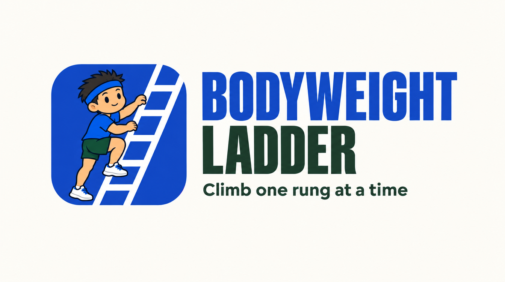

# Bodyweight Ladder

A phone-first training app for bodyweight strength, tendon health, mobility and stretching. Every exercise is a **ladder** of steps from easy to hard. Hit the top of the rep range on every set and you move up a rung. Rung, the mascot, shows each step.

## What it does
- **Plans your session from the time you have.** Pick 5, 10, 20, 30, 60 min or All. Overdue moves come first, with at most one new move when you already train.
- **One set at a time.** Adjust the suggested number, then Complete set. Rest fills the screen with a countdown ring before the next set. The final set saves the exercise, briefly confirms the save, and advances the workout. Subtle transitions respect Reduce Motion. Undo is available during rest and on the completion screen.
- **Details when you need them.** Technique, the workout list, and an editor for all sets stay collapsed. Time and routine choices live under Edit workout. Unfinished sets and rest deadlines resume after refreshing this browser.
- **Hold timer** for timed moves (3-2-1, counts up, buzz and beep at the goal, both sides for per-side moves) and **rest timer** with each move's own rest.
- **26 exercises** in groups: Strength (Push, Dip, Pull, Row, Squat, Core, Hinge), Tendon, Mobility, Stretch and Weights, plus your own custom moves.
- **Routines** (presets plus your own), **first-time setup**, **welcome back** after a break, **progress per exercise** in Progress.
- **Syncs across devices** when hosted as a claude.ai artifact (per-user database, merged entry by entry and setting by setting). Anywhere else it saves in the browser.

## Run it
It's one static page. Open `index.html`, or serve the folder. To put it on a server, see **[DEPLOY.md](DEPLOY.md)** (includes a copy-paste prompt for an AI agent on your VPS).

```bash
npm start          # serves on http://localhost:3000
```

## Tests
```bash
npm install
npm test
```
The tests run the real page in jsdom: data repair of old saves, Undo, two-device sync with a fake cloud (offline phones, clock skew, conflicting edits), the session planner, hold timer, setup, search and History.

## Files
- `index.html`: the whole app (HTML, CSS, JS)
- `img/`: Rung illustrations for every step (`<track>-<step>.webp`), app icon, logo banner and cheer image
- `img/w/`: start → finish two-pose pictures for moves where one pose doesn't show the movement
- `assets/brand/`: app icon (512px) and logo banner
- `assets/coaches/`: two designs for a second, female coach (not used in the app yet)
- `assets/mascot/rung-reference.png`: the reference image used to keep Rung consistent
- `tests/`: test files and runner

## Data model (v2)
`{ v, updated, stamps, levels:{track:"track:step-slug"}, log:[{ts,t,k,sets}], deleted:[], prefs:{hidden,focus,sets,presetsSeen,setupDone}, custom:[], routines:[] }`

Steps are identified by permanent keys (`pull:jumping-pull-up`), never by position, so ladders can be reordered safely. `stamps` records when each setting last changed, so devices merge setting by setting.

The separate `bwl-focus` localStorage key stores the unfinished session on this browser. It is not synced. Completed exercises still use the v2 log and its existing sync rules. Cancelling a hold records nothing; per-side holds record the weaker side. Changing the workout rebuilds the plan and carries forward unfinished sets for exercises included in the new plan.

## Known to-dos
- App icon: Rung's hands and feet should clearly grip the ladder rungs.
- Redo the remaining single-pose pictures in the newer athletic style so every picture matches.
- Optional second coach (female) with a "Choose your coach" setting. Designs are in `assets/coaches/`.
- Self-hosted copies save in the browser only. Cross-device sync needs a small backend.
